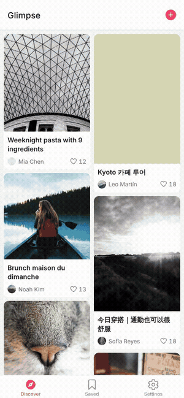
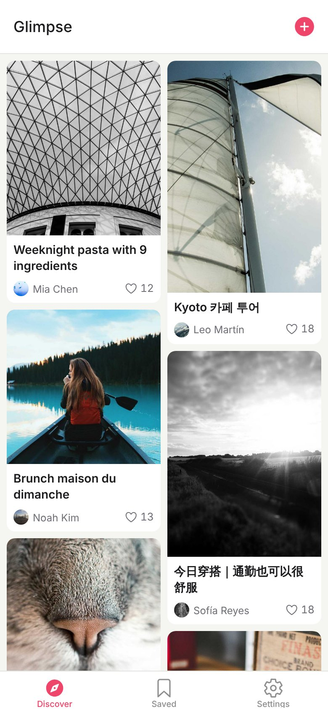
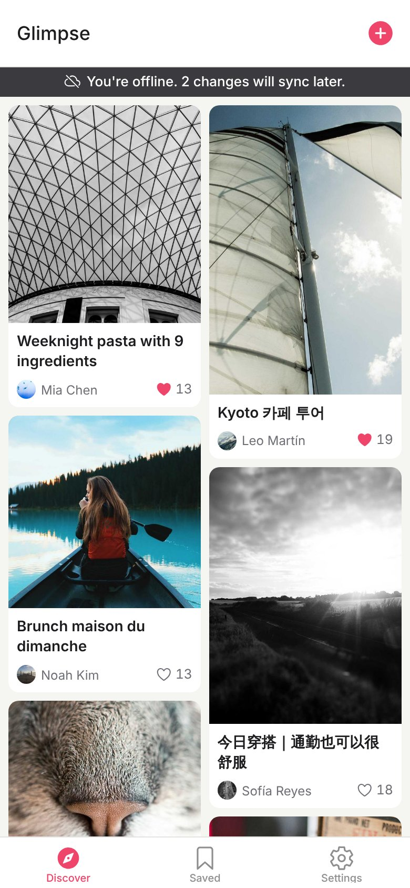
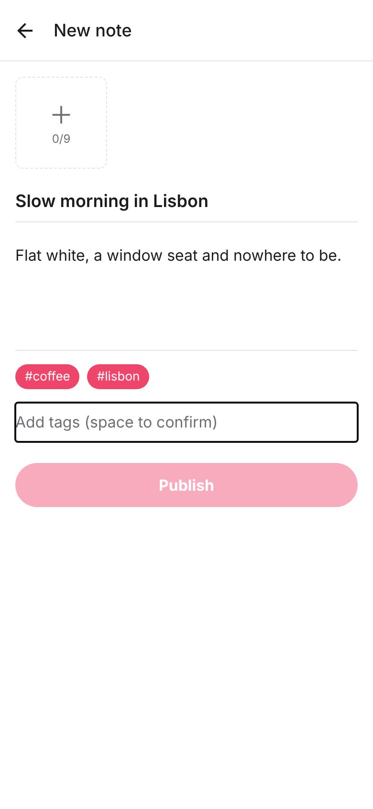
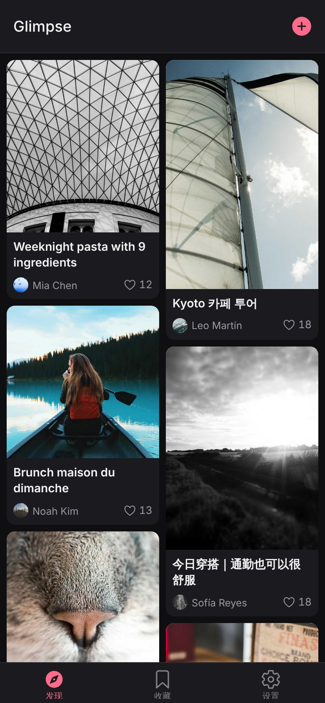
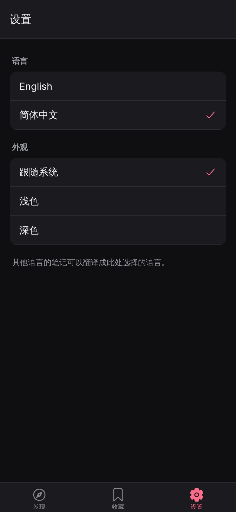
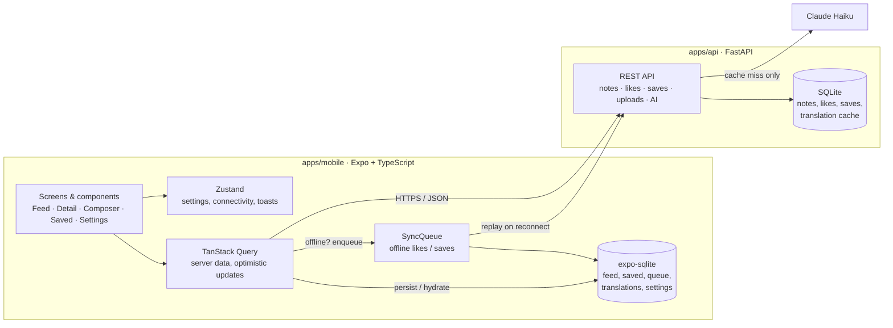

# Glimpse

A small lifestyle-notes app for international users: a two-column photo feed,
notes with image carousels, likes and saves that work offline, and AI
translation between languages. Built to practise React Native client
engineering end to end.

<p>
  
  
  
  
</p>
<p>
  
  
  
</p>

_Screenshots and GIF are captured from the Expo web build by
`apps/mobile/scripts/screenshots.cjs` (390×844 viewport). Photos are from
picsum.photos._

## Features

- **Feed** – masonry two-column grid (FlashList), infinite scroll with cursor
  pagination, pull-to-refresh, skeleton, empty and error states
- **Note detail** – swipeable image carousel, tags, like and save with
  optimistic updates and rollback on failure
- **Composer** – photo picker, title, body, tags, multipart upload
- **Offline** – feed and saved notes cached in SQLite; offline banner; likes and
  saves are queued, coalesced and replayed when the connection returns
- **AI** – translate a note into the UI language and get tag suggestions while
  writing. Claude Haiku is called by the backend only; results are cached on the
  server and on the device
- **Polish** – dark mode, English and Chinese UI, app icon and splash screen

## Architecture



Decisions worth knowing:

- **One source of truth per kind of state.** Server data lives in React Query,
  client preferences in Zustand. A single `patchNote` helper writes a note into
  every cache that holds it (feed pages, detail, saved list) and keeps the
  identity of everything else, so liking one note re-renders one card.
- **Likes and saves are end states, not toggles.** `PUT`/`DELETE
  /notes/{id}/like` are idempotent, which makes replaying the offline queue
  after a lost response safe.
- **Storage behind an interface.** `OfflineStore` has a SQLite implementation
  for iOS/Android and an in-memory one for the web preview and tests. The store
  and sync-queue tests run the real SQL through Node's built-in SQLite.
- **The API key never reaches the client.** `EXPO_PUBLIC_*` values are compiled
  into the bundle, so the app only knows the backend's address.
- **Cursor (keyset) pagination** keeps the feed stable when new notes are posted
  mid-scroll.

## Measured numbers

Everything below was produced by running the commands shown, on the commit that
introduced this README. Nothing here is estimated.

### Tests

| Suite | Result | Command |
| --- | --- | --- |
| Mobile unit/component (Jest + React Native Testing Library) | 122 tests in 20 suites, all passing | `npm test` |
| Mobile coverage | 83.3% statements, 78.1% branches, 76.9% functions, 84.9% lines | `npm run test:coverage` |
| API (pytest) | 20 tests, all passing | `pytest -q` |
| E2E (Maestro) | 1 flow written, **not executed** (no emulator available) | `maestro test .maestro/feed-like-translate.yaml` |

No test calls the network or the model: the API module and the AI client are
mocked.

### Feed performance, before vs after optimisation

Expo **web** build in headless Chromium, 4× CPU throttle, 390×844 viewport,
600 seeded notes, median of 5 runs
(`npm run perf:web`, raw data in [`docs/perf-web-results.json`](docs/perf-web-results.json)).
"Before" is a ScrollView feed without memoisation
(`src/perf/BaselineNoteGrid.tsx`); "after" is the shipped FlashList feed.

| Metric | Before | After |
| --- | ---: | ---: |
| Scroll frame rate while infinite-scrolling a fresh feed | 33 fps | 59.5 fps |
| 95th-percentile frame time during that scroll | 116.7 ms | 16.8 ms |
| Time spent in frames longer than 50 ms during that 15 s scroll | 7367 ms | 0 ms |
| Tap "like" → new count painted, with 500 notes loaded | 551.6 ms | 24.4 ms |
| Note cards mounted with 500 notes loaded | 500 | 15 |
| DOM nodes with 500 notes loaded | 7566 | 308 |
| JS heap with 500 notes loaded | 46.3 MB | 10.3 MB |
| Scroll frame rate over the already-loaded list | 60 fps | 60 fps |
| Time to first note card (cold load) | 1040 ms | 1021 ms |
| Cards re-rendered when one of 20 notes is liked (Jest) | 20 | 1 |

**These are browser measurements, not device measurements.** No iOS simulator
or Android emulator was available, so native scroll FPS and startup time have
not been measured. Two rows show no improvement and are reported as measured.
[`docs/PERFORMANCE.md`](docs/PERFORMANCE.md) explains each optimisation, how to
read these numbers, and how to measure on a phone.

## Run it

Requirements: Node 22, Python 3.11+.

**1. API**

```bash
cd apps/api
python -m venv .venv && source .venv/bin/activate
pip install -r requirements-dev.txt
python -m app.seed --count 600          # 600 demo notes
uvicorn app.main:app --host 0.0.0.0 --port 8000
```

AI features need `ANTHROPIC_API_KEY` in the environment (see
`apps/api/.env.example`). Without it everything else works and the app shows a
"translation unavailable" message.

**2. App**

```bash
cd apps/mobile
npm install
cp .env.example .env                    # set EXPO_PUBLIC_API_URL
npx expo start                          # press i / a, or w for the web preview
```

On a real phone or the Android emulator, `localhost` is the device itself:
use your computer's LAN IP, or `http://10.0.2.2:8000` on the Android emulator.

**3. Checks**

```bash
cd apps/mobile && npm run lint && npm run typecheck && npm test
cd apps/api && ruff check . && pytest -q
```

GitHub Actions runs the same checks on every pull request
(`.github/workflows/ci.yml`).

## Project layout

```
apps/mobile/src
  api/          fetch wrapper, endpoints, shared note cache helpers
  components/   NoteCard, NoteGrid, Avatar, TagChip, LikeButton, …
  features/     feed, note, composer, saved, settings
  offline/      OfflineStore (SQLite / memory), SyncQueue, persistence
  state/        Zustand stores
  i18n/         English and Chinese strings
  perf/         benchmark baseline and re-render test
apps/api/app    FastAPI routes, SQLite schema, seed script, AI client
.maestro/       E2E flow
docs/           performance notes, results, screenshots
```

## Known limits

- Demo authentication: the client sends a fixed `X-User-Id`; there are no
  accounts.
- The live Claude call has only been exercised through mocks; it has not been
  run against the real API from this repository.
- The API has a `Dockerfile` but has not been deployed anywhere yet. Uploaded
  images are stored on local disk, which a free host may wipe on restart.
- The web build keeps offline data in memory only; SQLite persistence is for
  iOS and Android.
